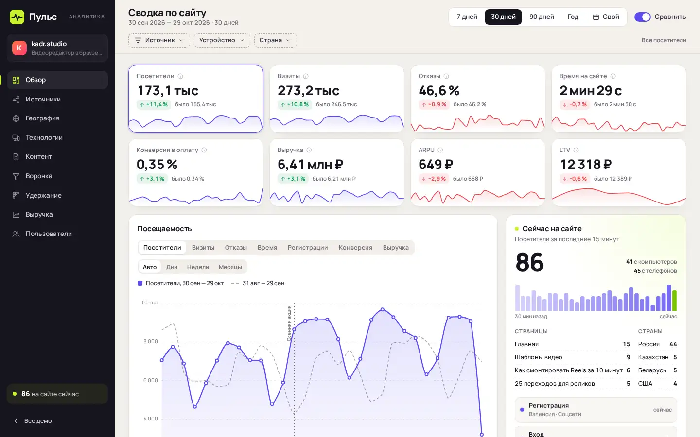

# Puls — web analytics dashboard

A web analytics dashboard in the spirit of Yandex Metrica and Google Analytics, built on demo data of a fictional browser video editor, kadr.studio.



Live page: https://onpress.pro/docs/v2/ru/guides/demo/analytics/

The interface is in Russian.

## Features

- Eight KPIs with change versus the previous period and sparklines
- Main chart over seven metrics with the previous period overlay and campaign markers
- Periods (7, 30, 90 days, year) and a custom date range
- Filters by source, device and country that recalculate every report
- Six traffic channels and UTM campaigns with ROMI
- World map with countries and cities
- Devices, browsers and operating systems
- Entry and exit pages
- Five-step conversion funnel
- Retention cohorts
- MRR and ARR by plan with churn
- Users table with a user card and payment history
- "On the site now" counter with a live event feed
- Deterministic demo data: 18 months, about 52,000 users and 96,000 payments

## Libraries

Loaded at runtime from jsDelivr with pinned versions. Nothing is bundled in this folder.

| Library | Version | Used for |
| --- | --- | --- |
| Apache ECharts | 5.6.0 | all charts and the world map |
| ECharts world map GeoJSON | 4.9.0 | country shapes (`echarts/map/json/world.json`) |
| @fontsource-variable/manrope | 5.2.8 | UI font |

## Real data

The dashboard runs on generated data. To show real numbers, let your agent or server fetch them from the analytics APIs with its own keys, write them to the site data with `PUT /data/{name}` and render them in the frame. See "External data" in the OnPress guides: https://onpress.pro/docs/v2/ru/guides/apps/external-data/

## Files

| File | What it is |
| --- | --- |
| `frame.html` | frame markup; `<!-- onpress/content /-->` prints the page text in the intro popup |
| `style.css` | frame stylesheet |
| `script.js` | frame script |
| `page.md` | page properties and the intro text |

## Deploy to OnPress

```bash
export ONPRESS_TOKEN=op_...   # your API token
export ONPRESS_SITE=...       # your site id
python3 deploy.py analytics --url /analytics/ --back-url /
```

This creates the frame `demo-analytics`, uploads `style.css` and `script.js` as frame files and publishes `page.md` as a page with `frame: "demo-analytics"`. `--back-url` sets where the "Back" buttons lead. The manual curl version and all options are in the [root README](../../README.md#deploy-a-demo-to-your-onpress-site).
