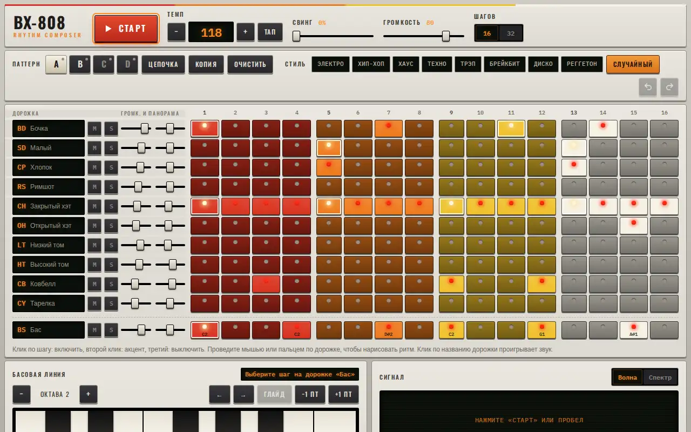

# BX-808 — drum machine

A TR-808-style rhythm composer. Every sound is synthesized with the Web Audio API, no samples are loaded.



Live page: https://onpress.pro/docs/v2/ru/guides/demo/beats/

The interface is in Russian.

## Features

- Ten synthesized drum voices and a bass line with an on-screen keyboard, octaves and glide
- 16 or 32 steps, accents on a second click, drawing a rhythm by dragging
- Tempo with tap tempo, swing, volume
- Mixer: volume and pan per track, mute and solo
- Four patterns A–D with copy and chain mode
- Style presets (electro, hip-hop, house, techno, trap, breakbeat, disco, reggaeton) and a random pattern
- Waveform and spectrum visualization
- Undo and redo, keyboard shortcuts (space to start and stop)
- Export to WAV rendered offline
- Share link with the beat in the URL, autosave in `localStorage`

## Libraries

Loaded at runtime from public CDNs with pinned versions (Google Fonts unless noted). Nothing is bundled in this folder.

| Library | Version | Used for |
| --- | --- | --- |
| Web Audio API | browser | sound synthesis and WAV rendering |
| Google Fonts: Oswald, IBM Plex Sans Condensed, IBM Plex Mono | — | UI fonts |

## Files

| File | What it is |
| --- | --- |
| `frame.html` | frame markup; `<!-- onpress/content /-->` prints the page text in the intro popup |
| `style.css` | frame stylesheet |
| `script.js` | frame script |
| `page.md` | page properties and the intro text with the H1 |

## Deploy to OnPress

```bash
export ONPRESS_TOKEN=op_...   # your API token
export ONPRESS_SITE=...       # your site id
python3 deploy.py beats --url /beats/ --back-url /
```

This creates the frame `demo-beats`, uploads `style.css` and `script.js` as frame files and publishes `page.md` as a page with `frame: "demo-beats"`. `--back-url` sets where the "Back" buttons lead. The manual curl version and all options are in the [root README](../../README.md#deploy-a-demo-to-your-onpress-site).
