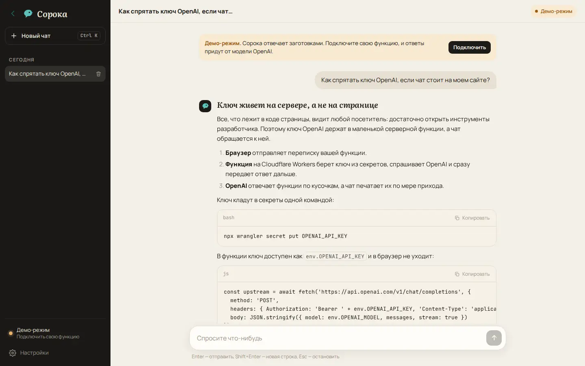

# AI chat

A ChatGPT-style chat with an OpenAI model that you can publish on an OnPress site without exposing your OpenAI API key. The answer streams in as the model writes it, Markdown in answers (code, lists, tables) is rendered safely, and conversations stay in the visitor's `localStorage`.



Live page: https://onpress.pro/docs/v2/ru/guides/demo/chat/

The interface is in Russian.

## How it works

```
Browser (chat on your OnPress page)
   │  POST {"messages": [...]}
   ▼
Your function (Cloudflare Worker, holds OPENAI_API_KEY)
   │  adds the key, calls OpenAI Chat Completions with stream: true
   ▼
OpenAI
   │  streams the answer back (server-sent events)
   ▼
Your function passes the stream through to the browser, chunk by chunk
```

The chat page never sees the key. The browser only knows the address of your function, and the function only answers requests from the sites you list in `ALLOWED_ORIGINS`.

Without a function address the chat runs in **demo mode**: it answers with prepared texts, streams them the same way, and shows how to connect your own function. The live page on onpress.pro runs in demo mode.

## Why the key cannot go into the frame

Everything in a frame (`frame.html`, `script.js`, page text) is sent to every visitor's browser. A key in the frame script is visible in the page source and in the network tab, and anyone can copy it and spend your OpenAI balance. OnPress has no secret settings for frame scripts, so the key lives on a server you control. A Cloudflare Worker is the smallest such server: one file, free plan, no machine to maintain.

## Deploy the function

You need Node.js, a Cloudflare account (the free plan is enough) and an OpenAI API key.

1. Copy the `worker` folder of this demo to your computer and open a terminal in it.

2. Edit `wrangler.toml`: put the address of your site into `ALLOWED_ORIGINS` (comma-separated, no trailing slash, for example `"https://example.com,https://www.example.com"`). Change `OPENAI_MODEL`, `SYSTEM_PROMPT` and the limits if you want.

3. Install Wrangler, the Cloudflare CLI, and log in:

   ```bash
   npm i -D wrangler@latest
   npx wrangler login
   ```

4. Store the OpenAI key as a secret. Wrangler asks for the value; if the Worker does not exist yet, it offers to create it.

   ```bash
   npx wrangler secret put OPENAI_API_KEY
   ```

5. Deploy:

   ```bash
   npx wrangler deploy
   ```

   Wrangler prints the address of the function, for example `https://onpress-chat.<your-subdomain>.workers.dev`.

To try the function locally, put `OPENAI_API_KEY="sk-..."` into a `.dev.vars` file next to `wrangler.toml`, run `npx wrangler dev` and use `http://localhost:8787` as the address. Never commit `.dev.vars`.

`npx wrangler tail` shows live logs of the deployed function.

## Connect the chat to the function

Any of these, the first one wins:

- **In the chat.** Open "Настройки" (Settings), paste the address into "Адрес вашей функции" and press "Сохранить". The address is stored in the browser's `localStorage`, so it is a per-browser setting. "Проверить связь" sends an `OPTIONS` request to check that the function answers and allows your site.
- **In the page properties.** Add `chat_endpoint: "https://onpress-chat.<your-subdomain>.workers.dev"` to `page.md` before deploying. The frame reads it with the data field `{{page.data.chat_endpoint}}`, and every visitor gets a working chat.
- **As a frame parameter.** If you insert the frame into another frame, pass the address as a parameter: `<!-- frame/demo-chat {"endpoint":"https://onpress-chat.<your-subdomain>.workers.dev"} /-->`. The frame reads it as `{{frame.endpoint}}`.

## Request and response

The chat sends:

```http
POST / HTTP/1.1
Content-Type: application/json

{"messages": [{"role": "user", "content": "Hi"}, {"role": "assistant", "content": "Hello!"}, {"role": "user", "content": "Write a haiku"}]}
```

The function answers with the OpenAI stream as is (`Content-Type: text/event-stream`), lines like `data: {"choices":[{"delta":{"content":"..."}}]}` ending with `data: [DONE]`. Passing the stream through without parsing keeps the function's CPU time minimal. Errors come back as JSON with an HTTP status:

| Status | `error.code` | When |
| --- | --- | --- |
| 400 | `bad_json`, `no_messages`, `bad_message` | the body is not `{"messages": [...]}` with `user`/`assistant` messages, or the last message is not from the user |
| 400 | `message_too_long`, `too_many_messages`, `history_too_long` | a limit below is exceeded |
| 403 | `origin_not_allowed` | the `Origin` of the request is not in `ALLOWED_ORIGINS` |
| 405 | `method_not_allowed` | not `POST` or `OPTIONS` |
| 413 | `too_large` | the body is far over the history limit |
| 429 | `rate_limited`, `upstream_error` | the rate limiter or OpenAI refused the request |
| 500 | `not_configured` | `OPENAI_API_KEY` is not set |
| 502 | `upstream_error`, `upstream_unreachable` | OpenAI returned an error or could not be reached |

## Limits and cost

The function has no storage of its own. It protects your key and balance with:

- **Allowed origins.** Browsers send the `Origin` header, and the function serves only `ALLOWED_ORIGINS`. This stops other websites from using your function from their pages. It does not stop scripts that fake the header, which is what the next limits are for.
- **Size limits.** `MAX_MESSAGES` (20), `MAX_MESSAGE_CHARS` (4000), `MAX_HISTORY_CHARS` (16000) and `MAX_OUTPUT_TOKENS` (1500) cap the cost of one request. The chat trims old messages to fit before sending.
- **Rate limit (optional).** The `[[ratelimits]]` block in `wrangler.toml` binds the [Workers Rate Limiting API](https://developers.cloudflare.com/workers/runtime-apis/bindings/rate-limit/): 10 requests per minute per IP address. It needs Wrangler 4.36.0 or later. Cloudflare documents the counters as approximate and per location, so treat it as protection from bursts, not exact accounting. The Cloudflare docs list no plan restriction for this binding; if `wrangler deploy` rejects it on your account, delete the block and the function works without it.

Cost: the Workers free plan allows 100,000 requests per day and 10 ms of CPU time per request; time spent waiting for OpenAI does not count as CPU time ([Workers pricing](https://developers.cloudflare.com/workers/platform/pricing/), [limits](https://developers.cloudflare.com/workers/platform/limits/)). You pay OpenAI for the tokens of every answer at the [price of the model](https://developers.openai.com/api/docs/models) you set in `OPENAI_MODEL`. Set a monthly budget limit in your OpenAI account as the last line of defense.

## Configuration

| Name | Kind | Default | What it does |
| --- | --- | --- | --- |
| `OPENAI_API_KEY` | secret | — | your OpenAI key, set with `wrangler secret put` |
| `ALLOWED_ORIGINS` | var | — | sites allowed to call the function, comma-separated |
| `OPENAI_MODEL` | var | `gpt-6-luna` | model for Chat Completions |
| `OPENAI_REASONING_EFFORT` | var | not sent | `reasoning_effort` for reasoning models, for example `low`; remove it for models without reasoning |
| `SYSTEM_PROMPT` | var | not sent | instructions sent as the first `developer` message |
| `MAX_MESSAGES`, `MAX_MESSAGE_CHARS`, `MAX_HISTORY_CHARS`, `MAX_OUTPUT_TOKENS` | var | 20, 4000, 16000, 1500 | limits per request |
| `RATE_LIMITER` | binding | off | optional rate limiter from `[[ratelimits]]` |

The function calls `https://api.openai.com/v1/chat/completions`. Any service with an OpenAI-compatible Chat Completions API works if you change `OPENAI_URL` in `worker.js`.

## Libraries

- [marked](https://marked.js.org/) 18.1.2 (MIT) turns Markdown in answers into HTML
- [DOMPurify](https://github.com/cure53/DOMPurify) 3.4.17 (MPL-2.0 or Apache-2.0) removes scripts and unsafe attributes from that HTML

Both load from jsDelivr. Fonts Manrope, Literata and JetBrains Mono come from Google Fonts. The Worker has no dependencies.

## Files

| File | What it is |
| --- | --- |
| `frame.html` | frame markup; `<!-- onpress/content /-->` prints the page text in the intro popup |
| `style.css` | frame stylesheet |
| `script.js` | frame script: chat, streaming, demo mode, history |
| `page.md` | page properties and the intro text |
| `worker/worker.js` | the Cloudflare Worker that holds the key and streams the answer |
| `worker/wrangler.toml` | Worker configuration: name, variables, optional rate limit |

## Deploy to OnPress

```bash
export ONPRESS_TOKEN=op_...   # your API token
export ONPRESS_SITE=...       # your site id
python3 deploy.py chat --url /chat/ --back-url /
```

This creates the frame `demo-chat`, uploads `style.css` and `script.js` as frame files and publishes `page.md` as a page with `frame: "demo-chat"`. `--back-url` sets where the "Back" buttons lead. `deploy.py` does not touch the `worker` folder: the function goes to Cloudflare with `wrangler deploy`. The manual curl version and all options are in the [root README](../../README.md#deploy-a-demo-to-your-onpress-site).
