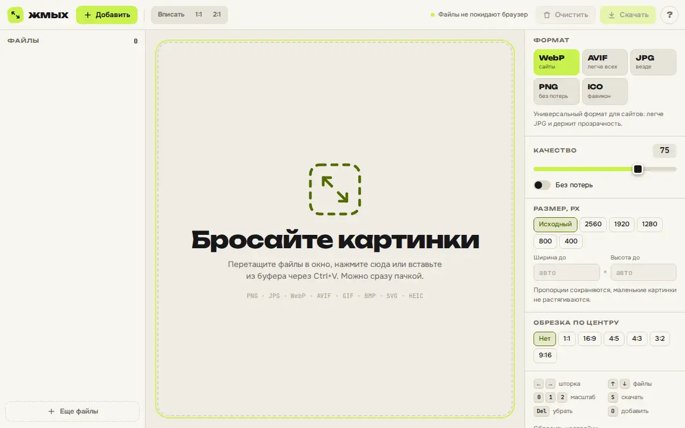

# Zhmykh — image converter

A Squoosh-style batch image converter. All encoding happens in the browser, files never leave the device.



Live page: https://onpress.pro/docs/v2/ru/guides/demo/converter/

The interface is in Russian.

## Features

- Batch input by drag and drop, file picker or paste from the clipboard: PNG, JPG, WebP, AVIF, GIF, BMP, SVG, HEIC
- Output to WebP, AVIF, JPG, PNG (lossless via OxiPNG) and ICO with several sizes
- Quality slider and lossless mode
- Resize with preserved aspect ratio, presets 2560 to 400 px
- Center crop to 1:1, 16:9, 4:5, 4:3, 3:2, 9:16
- Before and after comparison with a slider, size saved in percent
- Encoding in Web Workers with progress per file
- Download one by one or as a ZIP archive
- Keyboard shortcuts

## Libraries

Loaded at runtime from public CDNs with pinned versions (jsDelivr unless noted). Nothing is bundled in this folder.

| Library | Version | Used for |
| --- | --- | --- |
| @jsquash/webp | 1.5.0 | WebP encoder |
| @jsquash/avif | 2.1.1 | AVIF encoder |
| @jsquash/jpeg | 1.6.0 | MozJPEG encoder |
| @jsquash/oxipng | 2.3.0 | PNG optimizer |
| fflate | 0.8.3 | ZIP archive |
| heic2any | 0.0.4 | HEIC input |
| Google Fonts: Unbounded, Onest, JetBrains Mono | — | UI fonts |

## Files

| File | What it is |
| --- | --- |
| `frame.html` | frame markup; `<!-- onpress/content /-->` prints the page text in the intro popup |
| `style.css` | frame stylesheet |
| `script.js` | frame script |
| `page.md` | page properties and the intro text with the H1 |

## Deploy to OnPress

```bash
export ONPRESS_TOKEN=op_...   # your API token
export ONPRESS_SITE=...       # your site id
python3 deploy.py converter --url /converter/ --back-url /
```

This creates the frame `demo-converter`, uploads `style.css` and `script.js` as frame files and publishes `page.md` as a page with `frame: "demo-converter"`. `--back-url` sets where the "Back" buttons lead. The manual curl version and all options are in the [root README](../../README.md#deploy-a-demo-to-your-onpress-site).
