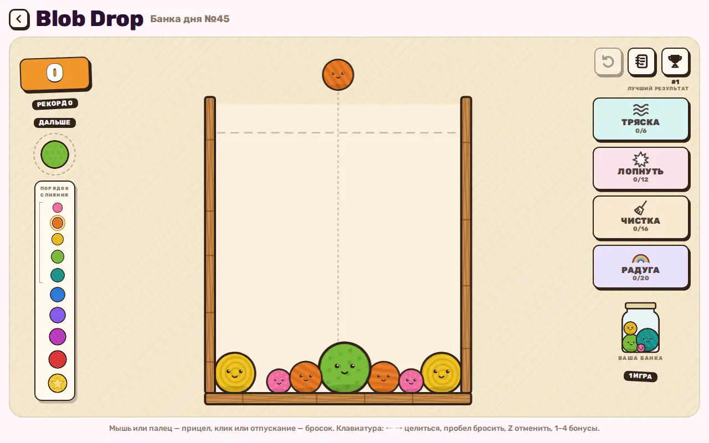

# Blob Drop — merge puzzle game

A physics puzzle: drop blobs into a jar, two equal blobs merge into a bigger one, the goal is a golden star before the jar overflows.



Live page: https://onpress.pro/docs/v2/ru/guides/demo/game/

The interface is in Russian.

## Features

- Physics of falling and merging blobs
- Four power-ups charged by merges: shake, pop, clean, rainbow
- Undo of the last drop
- Jar of the day
- Best results and an unfinished game kept in `localStorage`
- Mouse, touch and keyboard controls (arrows, space, Z, 1–4)
- Rules popup on every visit

## Libraries

Loaded at runtime from public CDNs with pinned versions (jsDelivr unless noted). Nothing is bundled in this folder.

| Library | Version | Used for |
| --- | --- | --- |
| matter-js | 0.19.0 | 2D physics |
| Google Fonts: Rubik | — | UI font |

## Files

| File | What it is |
| --- | --- |
| `frame.html` | frame markup; `<!-- onpress/content /-->` prints the page text in the intro popup |
| `style.css` | frame stylesheet |
| `script.js` | frame script |
| `page.md` | page properties and the intro text with the H1 |

## Deploy to OnPress

```bash
export ONPRESS_TOKEN=op_...   # your API token
export ONPRESS_SITE=...       # your site id
python3 deploy.py game --url /game/ --back-url /
```

This creates the frame `demo-game`, uploads `style.css` and `script.js` as frame files and publishes `page.md` as a page with `frame: "demo-game"`. `--back-url` sets where the "Back" buttons lead. The manual curl version and all options are in the [root README](../../README.md#deploy-a-demo-to-your-onpress-site).
