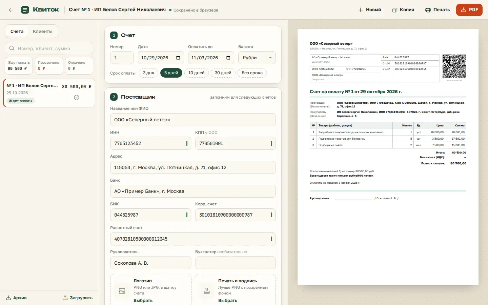

# Invoice generator

An invoice generator for Russian payment invoices: a form on the left and a live A4 sheet on the right.



Live page: https://onpress.pro/docs/v2/ru/guides/demo/invoice/

The interface is in Russian.

## Features

- Supplier and buyer details with checks of INN, BIK and bank accounts
- Line items with drag and drop reordering
- VAT included or on top, or no VAT
- Total in words for rubles, RUB, USD and EUR
- QR code for bank payment apps
- Logo, signature and stamp as images
- Accent color themes
- PDF with real text and Cyrillic, printing
- Invoice archive with statuses, clients directory, auto-numbering, copies
- Data kept in `localStorage`, archive export and import

## Libraries

Loaded at runtime from public CDNs with pinned versions (jsDelivr unless noted). Nothing is bundled in this folder.

| Library | Version | Used for |
| --- | --- | --- |
| pdfmake | 0.2.15 | PDF generation |
| qrcode-generator | 1.4.4 | payment QR code |
| number-to-words-ru | 2.4.1 | amount in words |
| SortableJS | 1.15.6 | reordering line items |
| @phosphor-icons/web | 2.1.1 | icons |
| Google Fonts: Unbounded, Golos Text, JetBrains Mono | — | UI fonts |

## Files

| File | What it is |
| --- | --- |
| `frame.html` | frame markup; `<!-- onpress/content /-->` prints the page text in the intro popup |
| `style.css` | frame stylesheet |
| `script.js` | frame script |
| `page.md` | page properties and the intro text with the H1 |

## Deploy to OnPress

```bash
export ONPRESS_TOKEN=op_...   # your API token
export ONPRESS_SITE=...       # your site id
python3 deploy.py invoice --url /invoice/ --back-url /
```

This creates the frame `demo-invoice`, uploads `style.css` and `script.js` as frame files and publishes `page.md` as a page with `frame: "demo-invoice"`. `--back-url` sets where the "Back" buttons lead. The manual curl version and all options are in the [root README](../../README.md#deploy-a-demo-to-your-onpress-site).
