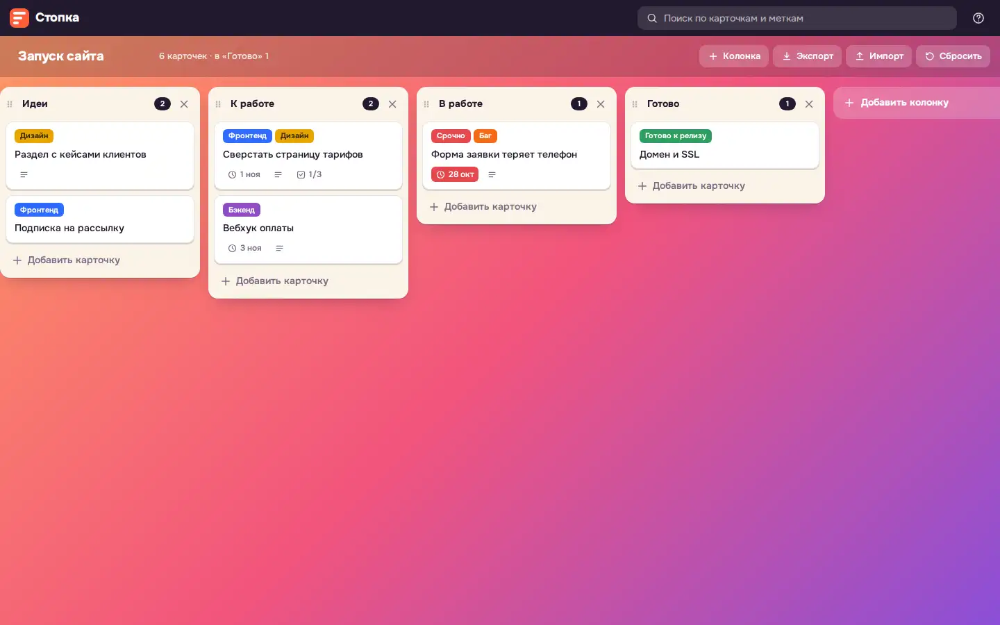

# Kanban board

A Trello-style kanban board that runs on one page and keeps everything in the browser.



Live page: https://onpress.pro/docs/v2/ru/guides/demo/kanban/

The interface is in Russian.

## Features

- Columns: add, rename, reorder by drag and drop, delete
- Cards with smooth drag and drop by mouse and touch
- Card window with a Markdown description, colored labels, checklists with progress, a due date with overdue highlighting
- Search across cards and labels (`/` to focus), Enter and Esc in editors
- Demo board on the first visit, reset to the demo board
- Export and import of the board as JSON
- Light and dark theme from `prefers-color-scheme`

## Use it as a work tool

Publish the board page with status `private` (or close the whole site) and only site administrators can open it. The board data stays in each browser's `localStorage`, so every teammate sees their own board; move a board between browsers with JSON export and import. A shared board needs the data in the site data, written by your agent through the API. See "Private page" and "App data" in the OnPress guides: https://onpress.pro/docs/v2/ru/guides/apps/#private and https://onpress.pro/docs/v2/ru/guides/apps/data/

## Libraries

Loaded at runtime from public CDNs with pinned versions (jsDelivr unless noted). Nothing is bundled in this folder.

| Library | Version | Used for |
| --- | --- | --- |
| SortableJS | 1.15.6 | drag and drop |
| marked | 12.0.2 | Markdown in card descriptions |
| DOMPurify | 3.2.6 | sanitizing rendered Markdown |
| @fontsource-variable/onest | 5.3.1 | UI font |

## Files

| File | What it is |
| --- | --- |
| `frame.html` | frame markup; `<!-- onpress/content /-->` prints the page text in the intro popup |
| `style.css` | frame stylesheet |
| `script.js` | frame script |
| `page.md` | page properties and the intro text with the H1 |

## Deploy to OnPress

```bash
export ONPRESS_TOKEN=op_...   # your API token
export ONPRESS_SITE=...       # your site id
python3 deploy.py kanban --url /kanban/ --back-url /
```

This creates the frame `demo-kanban`, uploads `style.css` and `script.js` as frame files and publishes `page.md` as a page with `frame: "demo-kanban"`. `--back-url` sets where the "Back" buttons lead. The manual curl version and all options are in the [root README](../../README.md#deploy-a-demo-to-your-onpress-site).
