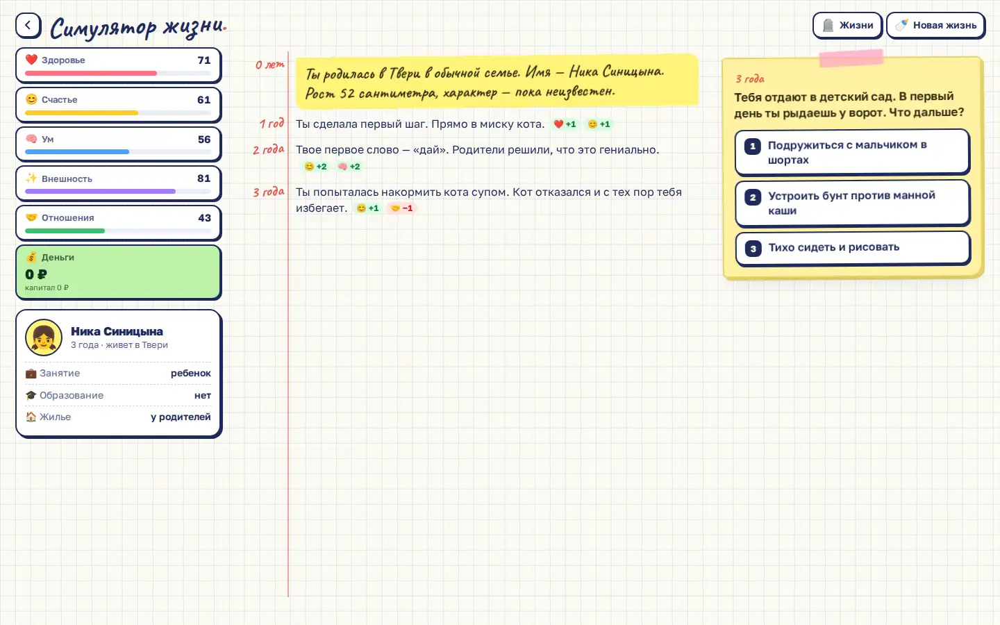

# Life simulator

A text life simulator: you live a whole life year by year, from birth to death, written as a diary in a school notebook. Every choice changes what comes next.



Live page: https://onpress.pro/docs/v2/ru/guides/demo/life/

The interface is in Russian.

## Features

- A life year by year from birth to death, shown as a handwritten diary
- Education: university with 7 faculties, college, master's degree
- 18 professions with career growth
- Money: rent, mortgage, car, savings deposit, stocks, buying cryptocurrency, own business, credit card, bankruptcy
- Relationships: wedding, divorce, children, inheritance
- Health and habits
- Six stats: health, happiness, smarts, looks, relationships, money
- 141 events, some with consequences years later
- Finale with an epitaph, a net worth chart and 30 achievements
- Life code to replay the same fate, and a graveyard of lives you have lived
- The current game and past lives are kept in `localStorage`

## Libraries

No libraries. Plain JavaScript; fonts Caveat and Golos Text come from Google Fonts.

## Files

| File | What it is |
| --- | --- |
| `frame.html` | frame markup; `<!-- onpress/content /-->` prints the page text in the intro popup |
| `style.css` | frame stylesheet |
| `script.js` | frame script |
| `page.md` | page properties and the intro text |

## Deploy to OnPress

```bash
export ONPRESS_TOKEN=op_...   # your API token
export ONPRESS_SITE=...       # your site id
python3 deploy.py life --url /life/ --back-url /
```

This creates the frame `demo-life`, uploads `style.css` and `script.js` as frame files and publishes `page.md` as a page with `frame: "demo-life"`. `--back-url` sets where the "Back" buttons lead. The manual curl version and all options are in the [root README](../../README.md#deploy-a-demo-to-your-onpress-site).
