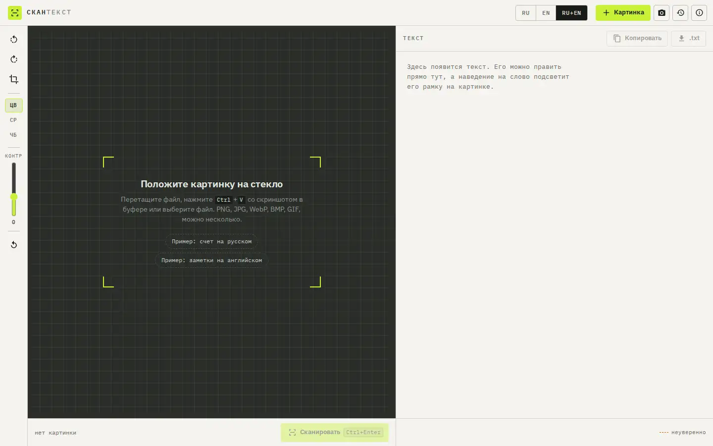

# SKANTEKST — text from images

An OCR scanner in the browser: Russian and English text from screenshots, photos and scans. The image never leaves the device.



Live page: https://onpress.pro/docs/v2/ru/guides/demo/ocr/

The interface is in Russian.

## Features

- Drag and drop, file picker, clipboard paste, phone camera
- Language: Russian, English or both
- Preprocessing: rotate, crop a region, color, grayscale or black and white, contrast
- Progress by stages
- Editable result with word boxes over the image and two-way highlighting
- Confidence marks for uncertain words
- Copy and download as .txt
- Queue of several images
- History of recent scans in `localStorage`
- Sample images to try it right away

## Libraries

Loaded at runtime from public CDNs with pinned versions (jsDelivr unless noted). Nothing is bundled in this folder.

| Library | Version | Used for |
| --- | --- | --- |
| tesseract.js | 5.1.1 | OCR engine |
| @fontsource/ibm-plex-sans | 5.3.0 | UI font |
| @fontsource/ibm-plex-mono | 5.3.0 | UI font |

## Files

| File | What it is |
| --- | --- |
| `frame.html` | frame markup; `<!-- onpress/content /-->` prints the page text in the intro popup |
| `style.css` | frame stylesheet |
| `script.js` | frame script |
| `page.md` | page properties and the intro text with the H1 |

## Deploy to OnPress

```bash
export ONPRESS_TOKEN=op_...   # your API token
export ONPRESS_SITE=...       # your site id
python3 deploy.py ocr --url /ocr/ --back-url /
```

This creates the frame `demo-ocr`, uploads `style.css` and `script.js` as frame files and publishes `page.md` as a page with `frame: "demo-ocr"`. `--back-url` sets where the "Back" buttons lead. The manual curl version and all options are in the [root README](../../README.md#deploy-a-demo-to-your-onpress-site).
