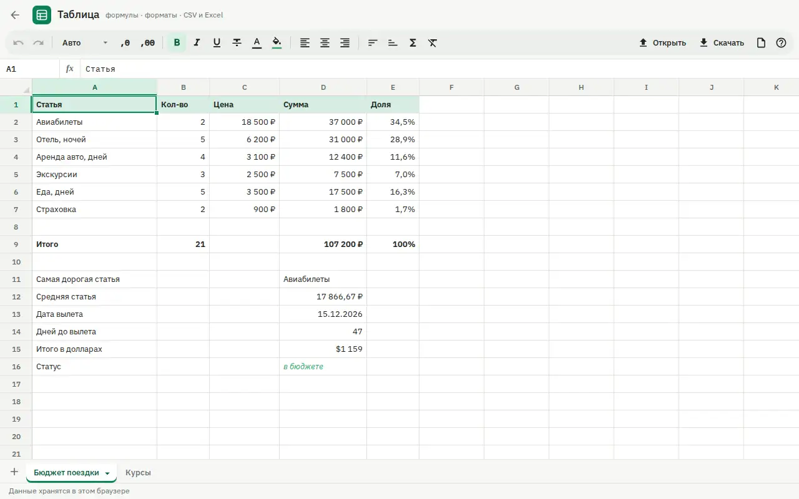

# Spreadsheet

A Google Sheets-style spreadsheet with a real formula engine, running fully in the browser.



Live page: https://onpress.pro/docs/v2/ru/guides/demo/sheets/

The interface is in Russian.

## Features

- Grid with range selection and a formula bar
- Almost 400 Excel functions with dependency recalculation, Russian function names (SUMM, ESLI) are understood
- Several sheets and cross-sheet references
- Number formats, currency, percent, decimals, bold, italic, colors, fill, alignment
- Autofill, sorting, AutoSum
- Insert and delete rows and columns, clipboard copy and paste
- Undo and redo
- Workbook saved in `localStorage`, travel budget example on the first visit
- Import and export of CSV and XLSX

## Libraries

Loaded at runtime from public CDNs with pinned versions (jsDelivr unless noted). Nothing is bundled in this folder.

| Library | Version | Used for |
| --- | --- | --- |
| HyperFormula | 3.5.0 | formula engine, **GPLv3** |
| SheetJS xlsx | 0.18.5 | XLSX import and export |

**License note.** HyperFormula is dual-licensed under GPLv3 and a commercial license; this demo uses it under GPLv3 with the `gpl-v3` license key. HyperFormula is loaded from jsDelivr and is not part of this repository, so the MIT license of this repository does not cover it. If you deploy this demo, your use of HyperFormula must follow GPLv3, or you need a commercial license from Handsontable.

## Files

| File | What it is |
| --- | --- |
| `frame.html` | frame markup; `<!-- onpress/content /-->` prints the page text in the intro popup |
| `style.css` | frame stylesheet |
| `script.js` | frame script |
| `page.md` | page properties and the intro text with the H1 |

## Deploy to OnPress

```bash
export ONPRESS_TOKEN=op_...   # your API token
export ONPRESS_SITE=...       # your site id
python3 deploy.py sheets --url /sheets/ --back-url /
```

This creates the frame `demo-sheets`, uploads `style.css` and `script.js` as frame files and publishes `page.md` as a page with `frame: "demo-sheets"`. `--back-url` sets where the "Back" buttons lead. The manual curl version and all options are in the [root README](../../README.md#deploy-a-demo-to-your-onpress-site).
