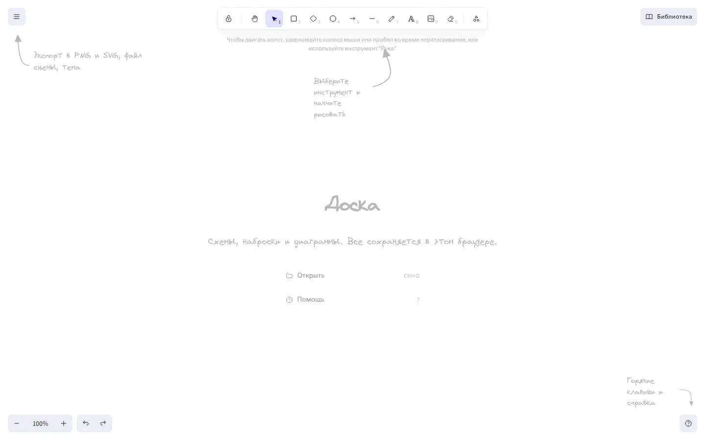

# Whiteboard

An Excalidraw-based whiteboard on an infinite canvas, embedded in an OnPress frame.



Live page: https://onpress.pro/docs/v2/ru/guides/demo/whiteboard/

The interface is in Russian.

## Features

- Infinite canvas with pan and zoom
- Shapes, arrows with binding, lines, freehand drawing, text, images, eraser
- Hand-drawn style, colors and stroke widths
- Undo and redo, keyboard shortcuts
- Autosave of the scene in `localStorage`
- Export to PNG and SVG, scene file import and export
- Russian interface

## Libraries

Loaded at runtime from public CDNs with pinned versions (unpkg unless noted). Nothing is bundled in this folder.

| Library | Version | Used for |
| --- | --- | --- |
| React | 18.3.1 | runtime for Excalidraw |
| ReactDOM | 18.3.1 | runtime for Excalidraw |
| @excalidraw/excalidraw | 0.17.6 | the editor |

## Files

| File | What it is |
| --- | --- |
| `frame.html` | frame markup; `<!-- onpress/content /-->` prints the page text in the intro popup |
| `style.css` | frame stylesheet |
| `script.js` | frame script |
| `page.md` | page properties and the intro text with the H1 |

## Deploy to OnPress

```bash
export ONPRESS_TOKEN=op_...   # your API token
export ONPRESS_SITE=...       # your site id
python3 deploy.py whiteboard --url /whiteboard/ --back-url /
```

This creates the frame `demo-whiteboard`, uploads `style.css` and `script.js` as frame files and publishes `page.md` as a page with `frame: "demo-whiteboard"`. `--back-url` sets where the "Back" buttons lead. The manual curl version and all options are in the [root README](../../README.md#deploy-a-demo-to-your-onpress-site).
